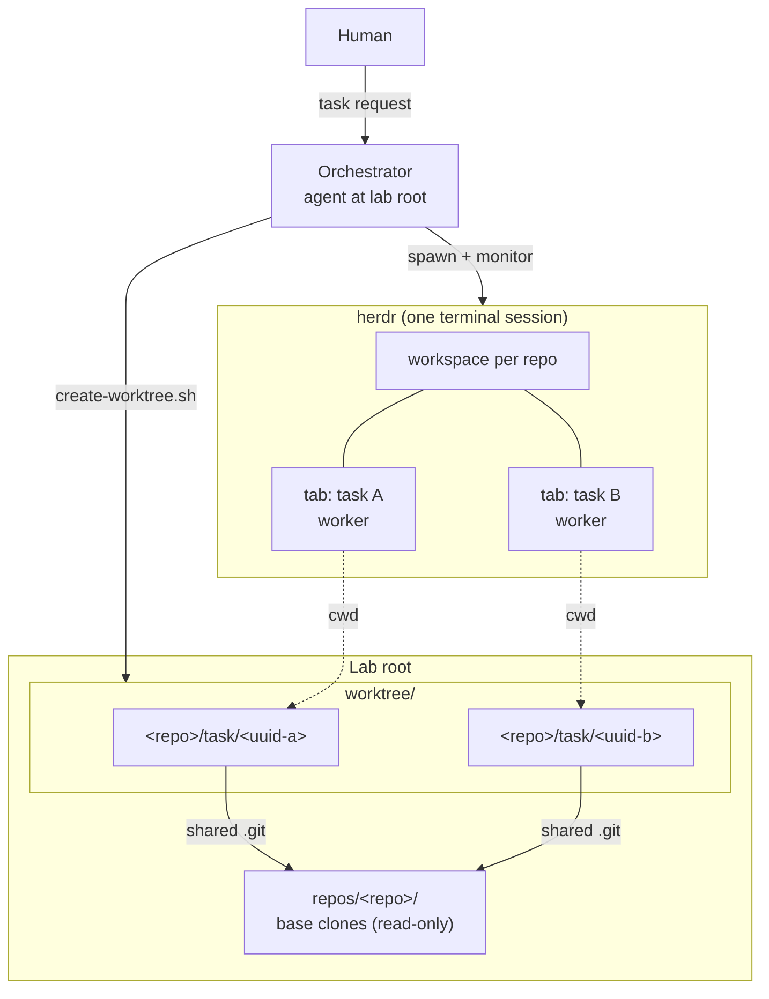

# Overview

## Goal

Enable safe, concurrent development across multiple repositories from a
single terminal, orchestrated through herdr.

- One task = one isolated `git worktree`; the base clone is never edited.
- A human talks to one **Orchestrator**; real work runs in separate
  **Worker** agent processes.
- Each worker operates inside the target repository, so that repo's own
  `AGENTS.md` and skills load — workers need no knowledge of herdr-worktree.

## Non-Goal

- The orchestrator does **not** perform delegated work on other
  repositories in-process — it manages workspaces, workers, and status
  reporting. The single exception is development of the herdr-worktree
  repo itself, which the orchestrator does directly in this checkout on
  a feature branch (see the `development` skill, ADR-0006).
- The orchestrator does **not** autonomously decompose the human's
  requirements and drive workers in a development loop — dispatch happens
  per explicit request.
- Workers are **not** injected with this project's rules or
  project-level skills — herdr-worktree must not leak side effects into the
  worker's repo; only the target repo's own conventions apply. That is
  why herdr-worktree has no root `AGENTS.md`/`CLAUDE.md`: agents such as pi
  load context files from every parent directory of a worktree
  (ADR-0005).
- No OS-level confinement of workers — they run unconfined (ADR-0007).
- No worker→orchestrator reporting protocol — monitoring is pull-based
  via herdr.
- No support for SSH git remotes — herdr-worktree clones and pushes over
  HTTPS via `gh`.

## Requirements

- Multiple tasks, possibly in different repositories, run concurrently
  without branch/index collisions.
- Repository-specific conventions (`AGENTS.md`, `.agents/skills`) apply
  inside the worker's own repo.
- The human can observe and steer each worker through herdr (tabs, panes,
  prompts) from one terminal.

## Background

Coding agents are typically run in one repo checkout at a time. Parallel
tasks on a shared checkout collide on branch state and uncommitted files;
separate clones waste setup and lose a shared base. Worktrees solve the
git side cheaply. Herdr already provides the UX for running many agent
processes (workspaces, tabs, panes); what's missing is the glue that binds
each agent to an isolated worktree. herdr-worktree is that glue.

## High-level architecture



## Directory layout

```
<lab root>/
├── repos/<repo>/                    # Base clones — read-only, never edited
├── worktree/<repo>/<branch>/        # Active worktrees — all edits happen here
├── scripts/                         # Scripts + git hooks
├── .agents/                         # canonical skills + Antigravity config
├── .claude/                         # Claude Code config (skills → symlink)
├── docs/design/                     # design docs (OKF v0.2)
├── docs/adr/                        # architecture decision records
└── tests/                           # shell test suites
```

Two topologies are supported: **split** (`<lab>/worktree/<repo>/<branch>`
checkouts under a shared lab root) and **unified** (the checkout is itself
the lab root).

## Components

| Component | Responsibility | Doc |
|---|---|---|
| Orchestrator | Receives the human's request, dispatches workers, reports worker status on request. Implements only herdr-worktree itself, in this checkout on a feature branch (`development` skill) | [orchestration.md](orchestration.md) |
| Worker | Executes the task inside its assigned worktree; may use repo-local and global skills; runs unconfined | [orchestration.md](orchestration.md) |
| Agent configs | Per-CLI config dirs + canonical `.agents/skills` | [../reference/agent-configs.md](../reference/agent-configs.md) |
| Skills | Slash-command procedures available to the orchestrator | [../reference/skills.md](../reference/skills.md) |
| Scripts | `setup-repo`, `create-worktree`, `spawn-repo-agent` — import, isolation, dispatch | [../reference/scripts.md](../reference/scripts.md) |

## Security posture

- Nothing is confined: neither the orchestrator nor the workers run
  under a sandbox or guard hooks (ADR-0007). Each agent runs
  with its own permission mode; the rules in the `development` skill are
  conventions, not enforced.

## Testing

```bash
for t in tests/scripts/test-*.sh; do bash "$t"; done   # per-script tests
```

## References

- herdr — terminal workspace manager for agent processes
- git worktree — https://git-scm.com/docs/git-worktree
- Google Open Knowledge Format v0.2 — frontmatter convention used in `docs/`

## In this directory

| Doc | Contents |
|---|---|
| [orchestration.md](orchestration.md) | How to ask the orchestrator to run workers — single-call dispatch via `spawn-repo-agent.sh` (task optional) with prompt-stall recovery; lifecycle, monitoring, natural-language reporting, ownership, cleanup |

Fact inventories (config tables, script/skill lists) live in
[../reference/](../reference/). Decision records live in
[../adr/](../adr/).

## Notes

Design docs describe *what* and *why*; implementation detail lives in the
code, which agents can read directly. Keep docs at the level of invariants
and intent — detailed specs rot faster than they help. All docs here use
OKF v0.2 frontmatter; each doc's `sources:` list declares the files it is
derived from and CI fails a PR that changes a source without the doc
(`scripts/check-docs-stale.sh`; see `CONTRIBUTING.md`).
