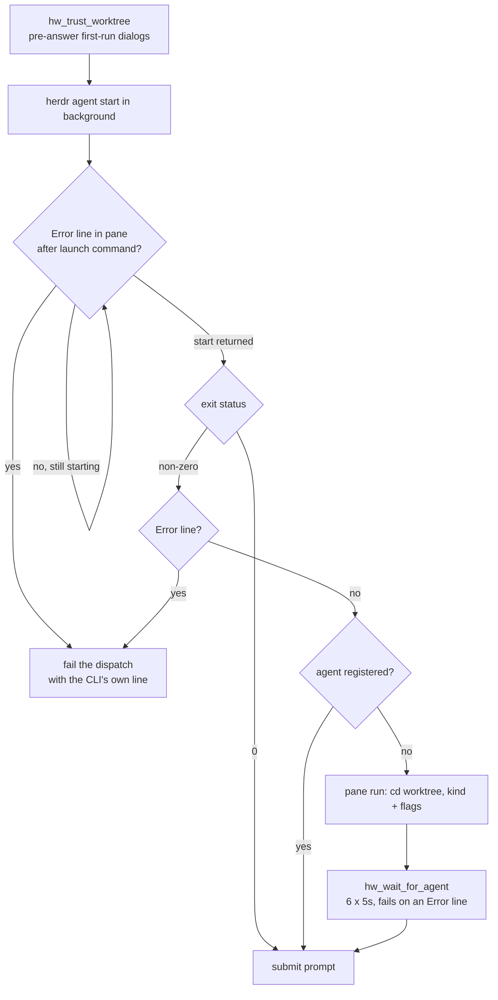
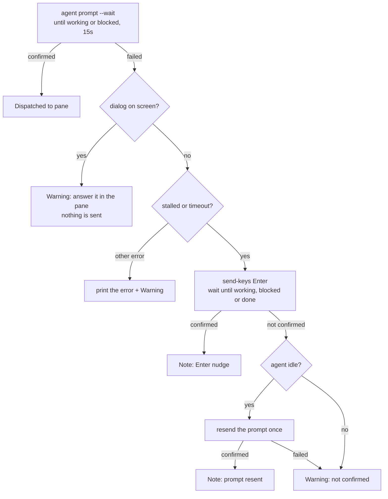

# Agent CLIs

[orchestration.md](orchestration.md) covers the dispatch sequence and
steering. This doc covers the agent side: what `spawn-repo-agent.sh` does
so that each CLI starts unattended in a fresh worktree and picks up its
prompt.

## Goal

- Start any supported agent CLI in a new worktree with no human at the
  keyboard: no first-run dialog, no lost prompt, no 30-second hang when
  the CLI dies at startup.
- Pass a model and an effort level only when the human named them, in
  the CLI's own syntax, and reject a value the CLI cannot take.
- Give every worker the same two rules, whatever the CLI: rename yourself
  once the task is clear, and reply in the human's language.

## Non-goals

- No per-CLI wrapper or hook: the worker is the stock CLI plus flags, and
  nothing from herdr-worktree runs inside it (ADR-0005, ADR-0007).
- No answering of dialogs at runtime. Predictable ones are answered in
  config before launch (ADR-0009); any other is left for the human.
- No validation of model ids. They pass through; an id the account cannot
  use fails fast at launch.
- No cleanup of trust entries for removed worktrees; they are harmless.

## Design

### Supported kinds and launch flags

`--kind` defaults to `claude` (`antigravity` means `agy`) and goes to
`herdr agent start --kind`; the script adds only these flags:

| Kind | Permission / trust flags | `--model` | `--effort` |
|---|---|---|---|
| `claude` | `--permission-mode auto` | `--model` | `--effort` |
| `agy` | `--dangerously-skip-permissions` | `--model` | `--effort` |
| `codex` | none | `--model` | `-c model_reasoning_effort="<e>"` |
| `pi` | none | `--model` | `--thinking` |
| `devin` | `--permission-mode dangerous --respect-workspace-trust false` | `--model` | rejected |

Each worker runs with its CLI's own permission mode and no sandbox
(ADR-0007). Other kinds that herdr knows can be started too, but with no
extra flags, and `--model`/`--effort` are refused for them. Codex flags are
implemented but have not been tested against a live CLI
([../reference/agent-configs.md](../reference/agent-configs.md)).

The agent starts under the placeholder name `w-<id>`, where `<id>` is
`hw_short_id`: 12 lowercase hex characters, the same id as the worktree's
`task/<id>` leaf. herdr requires agent names to be lowercase.

### Model and effort pass-through (ADR-0010)

`--model` and `--effort` are independent. Leaving one out, or giving
`inherit`, means no flag is passed, so the CLI's own settings apply. The
effort is checked before anything is created:

1. `agent-models.sh <kind> efforts` returns the levels for the whole kind.
   An empty list means the kind takes no effort on the command line, and
   the request is rejected. For devin, the error names the model-id form
   instead, e.g. `claude-opus-5-5-high`.
2. When `--model` is given and the catalog lists levels for that model
   (codex, and pi custom models), those levels replace the kind's list.
3. The effort must match an entry exactly. The error lists the valid
   values plus `inherit`.

The catalog (`agent-models.sh`) exists because each CLI reports this
differently and slowly: claude has no list command (a built-in list, levels
from `claude --help`), codex a JSON catalog, pi `--list-models` plus the
`thinkingLevelMap` in its `models.json`, and devin needs a login
([../reference/scripts.md](../reference/scripts.md) lists the sources).

Each kind has two cache files, `<kind>.models` and `<kind>.efforts`, under
`${AGENT_MODELS_CACHE_DIR:-${XDG_CACHE_HOME:-~/.cache}/herdr-worktree/agent-models}`.
The pair is rebuilt when either file is missing, older than
`AGENT_MODELS_TTL_DAYS` (default 7), or with `--refresh`; answers land in
temp files that are moved into place. When a CLI is missing, or devin is
logged out, a built-in fallback is printed (claude's list and default
levels, devin's documented aliases, nothing for the others) and nothing
is cached, so the next call asks again instead of keeping the fallback for
a week. So with `agy`, `codex` or `pi` not installed, `--effort` is
rejected for them — that launch would have failed anyway.

With `--machine`, all of this (and the trust files below) happens on that
machine, whose own script gets the arguments ([plugins/](plugins/README.md)).

### Pre-answering first-run dialogs (ADR-0009)

Every dispatch creates a new worktree path, and each CLI asks about an
unknown directory the first time it sees one. The worker would sit at
that question, and herdr can report it as idle. `hw_trust_worktree`
writes the answers into each CLI's own config before launch:

- **claude**: `${CLAUDE_CONFIG_DIR:-~}/.claude.json` → `projects[<wt>]`.
  Trust is set to accepted. The prompt about external `CLAUDE.md` imports
  is pre-answered "No", so a `CLAUDE.md` above the worktree (such as this
  checkout's own) cannot bring its rules into the worker.
- **agy**: `~/.gemini/antigravity-cli/settings.json` → `trustedWorkspaces`.
- **pi**: `${PI_CODING_AGENT_DIR:-~/.pi/agent}/trust.json` → `{<wt>: true}`.
  Pi's trust check walks up through every parent directory and finds
  herdr-worktree's `.agents/skills`, but its skill discovery stops at the
  repository root. Trusting the worktree therefore loads only the repo's
  own resources.
- **devin**: no file. It is launched with `--respect-workspace-trust false`.
- **codex**: nothing is written.

A file is edited only when the CLI looks installed (claude's and agy's
settings file exists; pi's config directory exists, and `trust.json` is
created in it), and the step is skipped without `jq`. The locations follow
the variables the CLIs themselves read; herdr-worktree's own config
directories are in [../reference/agent-configs.md](../reference/agent-configs.md).

These files are shared with the running CLIs and parallel dispatches,
so every edit goes through `hw_json_merge` (`scripts/lib/json.sh`): a
`mkdir` lock directory (atomic everywhere; `flock(1)` is Linux-only,
ADR-0011), then the jq filter into a `mktemp` file moved into place. A
failing filter leaves the file unchanged; a file that is not a JSON object
is copied to `<file>.corrupt-XXXXXX.bak` and the merge starts from `{}`.
The lock is retried every 0.1 s, broken as stale about every 10 s, and
given up after about 30 s, which fails the dispatch.

### Startup failure detection (ADR-0008)

A CLI that exits at startup (a model the account cannot use, a bad flag,
no login) never registers, and `herdr agent start` would wait out its full
readiness timeout. So `agent start` runs in the background while the pane
is polled every second with `hw_launch_error`: it finds the latest line
naming the kind as a word (the launch command) and prints the first
`Error:`/`fatal` line after it, so older output is ignored and the CLI's
own message (devin's plan-locked model, say) becomes the dispatch error.

The `pane run` fallback exists because the calling agent's permission
classifier can deny `agent start`; typing `cd <wt> && <kind> <flags>` into
the pane is not denied, and the CLI registers through its SessionStart
hook. Flags are `%q`-quoted (a model like `opus[1m]` would glob). The
fallback is skipped when an `Error:` line already explains the failure.

### Prompt submission and recovery (ADR-0008)

`herdr agent prompt` pastes the text and presses Enter. TUI agents using
bracketed paste (claude, devin) can swallow the Enter, leaving the text
unsubmitted: herdr reports `agent_prompt_stalled`, or the 15 s limit runs
out first. Recovery is one real
`herdr pane send-keys <pane> Enter` and a new wait; if the agent is then
still `idle`, the paste never arrived and the prompt is resent once.

`hw_pane_has_dialog` runs first: an agent showing a dialog can look idle,
and an Enter or a resend would answer it (a pi worker once accepted its
trust dialog this way). It is a text heuristic over the pane's last 30
lines (`enter to select/confirm/continue`, `esc to skip/cancel`, trust
wording, `allow external`, `update available`); on a match nothing is
sent. Other errors such as `agent_blocked` are never nudged — a stray
Enter could accept a permission prompt. `Note:`/`Warning:` lines tell the
orchestrator to look at the pane; a clean `Dispatched to pane …` already
confirms the start.

Every later prompt uses the same `--wait --until working --until
blocked`: the hint printed for an idle worker, and the relays in
`herdr-control`. It returns once the worker is working, at once for a
busy one whose CLI queues the text, and never waits for the worker's
turn (ADR-0023). For a busy worker herdr confirms nothing, so the
orchestrator reads the screen once and applies the same single Enter,
never while a dialog shows; it does the same after
`agent_prompt_stalled` or `timeout` on a relay to an idle worker.

### The prompt contract: self-naming and language

Every spawn sends a prompt, task or not. It is the whole contract; the
worker needs to know nothing about herdr-worktree:

- **Self-naming (ADR-0004)**: the pane id, the tab id (from
  `herdr pane get`, else `unknown`), the exact `herdr agent rename` /
  `herdr tab rename` commands and the slug rules (lowercase letter first,
  `[a-z0-9_-]`, at most 32 characters). Only the worker can name the task;
  one that skips the rename is still reachable by pane id.
- **Standby**: without a task, the prompt names the repository and
  worktree, asks for a brief acknowledgement and no changes, and keeps the
  rename rule for the task that arrives through `herdr agent prompt`.
- **Language (ADR-0012)**: think in English; reply in the `--reply-lang`
  language even to English prompts, or without it in the language the
  human writes in. Code, commits and repository files follow the
  repository's conventions. It is a prompt instruction, not enforced.

## Testing

- `tests/scripts/spawn-repo-agent.bats` stubs `herdr` and `gh`: flags per
  kind (`--model=`/`--effort=` forms, `inherit`), effort rejection, fast
  failure on a startup `Error:` (and ignoring one before the launch
  command), the Enter nudge, the resend, dialogs and update prompts
  blocking both, claude and pi trust seeding, standby, `--reply-lang`.
- `tests/scripts/agent-models.bats`: per-kind parsing, cache freshness and
  `--refresh`, uncached fallbacks, devin logged in and out.
- `tests/scripts/lib/{agent-trust,json,herdr,common}.bats` test the library
  functions one by one. `tests/scripts/helpers.bash` unsets
  `CLAUDE_CONFIG_DIR` and `PI_CODING_AGENT_DIR`, so no test edits a real
  agent config.

## References

- ADRs: [ADR-0004](../adr/0004-worker-self-naming.md),
  [ADR-0005](../adr/0005-skills-instead-of-root-context-files.md),
  [ADR-0007](../adr/0007-no-confinement.md),
  [ADR-0008](../adr/0008-startup-and-prompt-recovery.md),
  [ADR-0009](../adr/0009-pre-answer-first-run-dialogs.md),
  [ADR-0010](../adr/0010-model-and-effort-pass-through.md),
  [ADR-0011](../adr/0011-macos-portability.md),
  [ADR-0012](../adr/0012-language-contract-and-worker-steering.md)
- Docs: [orchestration.md](orchestration.md) (the dispatch sequence and
  steering), [plugins/](plugins/README.md) (`--machine`),
  [../reference/scripts.md](../reference/scripts.md) (`spawn-repo-agent.sh`
  and `agent-models.sh` options),
  [../reference/agent-configs.md](../reference/agent-configs.md)
- Code: `scripts/spawn-repo-agent.sh`, `scripts/agent-models.sh`,
  `scripts/lib/agent-trust.sh`, `scripts/lib/json.sh`,
  `scripts/lib/herdr.sh`, `scripts/lib/common.sh`
