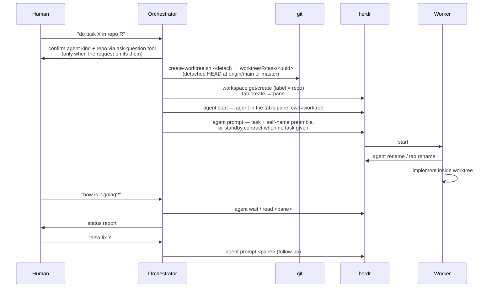
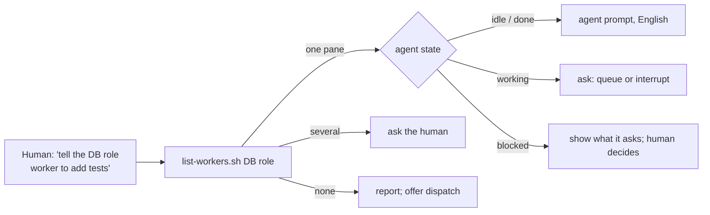
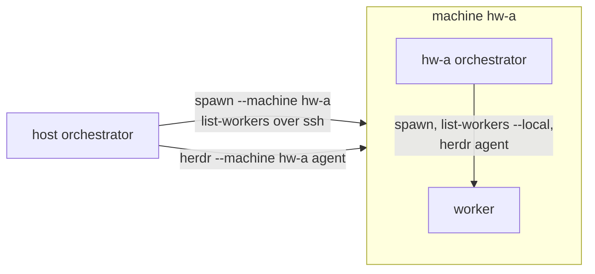

# Orchestration

## Goal

Let the human delegate work to a separate worker process that runs inside
the target repository — so the repo's own `AGENTS.md` and `.agents/skills`
load — while the orchestrator retains control through herdr.

## Design

Key decisions (see ADR-0003, ADR-0004, ADR-0008, ADR-0009, ADR-0010, ADR-0012):

- **Herdr-native model**: one workspace per repo (matched by label), one
  tab per task, the worker in the tab's root pane. No herdr-worktree-side state
  to keep in sync.
- **Self-naming**: agents spawn as `w-<uuid>`; the prompt preamble asks
  the worker to rename itself and its tab once it understands the task.
  The worker knows nothing about herdr-worktree — the preamble is the whole
  contract.
- **Detached start**: task worktrees begin on a detached HEAD at
  `origin/main` (`origin/master` for a repo without main); a branch is named only once the work — and its slug —
  is known (see ADR-0002).
- **Ask before dispatch**: when the request omits the agent kind or the
  repository, the orchestrator asks the user through its ask-question
  tool (`AskUserQuestion`/`ask_user_question`/`ask_question` — the name
  varies per agent) rather than defaulting silently (ADR-0003).
- **Dispatch is a single call**: `spawn-repo-agent.sh` is the only entry
  point and runs the whole sequence — worktree, tab, spawned agent,
  prompt. The orchestrator never runs `create-worktree.sh` for another
  repo and stops there: a worktree without a worker is a half-finished
  task. Missing inputs are collected *before* dispatch, not after.
- **The task is optional**: spawning alone is a valid use (pre-warmed
  standby, interactive steering). With no task the worker still gets a
  standby prompt carrying only the self-naming contract — rename agent +
  tab when a real task arrives — so follow-up
  `herdr agent prompt <pane> "<task>"` keeps names meaningful.
- **Model and effort pass-through**: when the human names a model or an
  effort level, the orchestrator passes it via `--model` / `--effort`,
  independently; the script maps them to each CLI's flags. Unspecified
  means inherit — no flag is passed and the CLI's own settings apply.
  A value a kind or model cannot take is rejected, not silently ignored.
- **Cached model catalog**: model ids and effort levels come from
  `agent-models.sh`, which caches each CLI's answer, so dispatch never
  re-queries the CLIs and the orchestrator resolves names from one list.
- **Language contract**: agents think in English and reply to the
  human in the human's natural language. The orchestrator passes that
  language at dispatch (`--reply-lang`), and the prompt preamble carries
  the rule to the worker; prompts to workers are written in English.
- **Pull-based monitoring**: workers carry no reporting protocol;
  `herdr agent wait/read/prompt` is the interface.
- **Dispatch output is the startup confirmation**: the script already
  waits for agent readiness and prompt pickup, so after a clean
  `Dispatched to pane …` the orchestrator reports immediately — no extra
  `agent wait`/`read`. The pane is inspected only on a `Warning:`/`Error:`
  or when the human asks for status.
- **Stall recovery on prompt submit**: `herdr agent prompt` pastes the
  prompt + Enter "atomically", but TUI agents running bracketed paste
  can swallow the trailing Enter — the paste sits unsubmitted while
  herdr reports `agent_prompt_stalled`. The script recovers by sending
  a real `herdr pane send-keys <pane> Enter` and re-waiting; other
  failure modes (e.g. `agent_blocked`) are never nudged, since a stray
  Enter could accept a permission prompt.

## Responsibilities

- **Orchestrator**: workspace and worker lifecycle management, status
  checks on request. Does not perform the delegated work itself. Reports
  to the human in natural language — the orchestrator runs every herdr
  command itself; a command is quoted only when the human asks how to do
  it by hand.
- **Worker**: executes the task in its worktree; may use repo-local and
  global skills. It runs unconfined — staying inside the worktree is a
  convention, not enforced.

## Steering a worker

The orchestrator is not the worker's owner — it is the spawner. Once a
worker is running, the human can always talk to it directly: focus the
herdr tab and type, or `herdr agent prompt <pane> "<instruction>"` from
any shell.

Only caveat: avoid the human and the orchestrator prompting the same
worker concurrently — contexts interleave. In principle the side that
spawned the worker manages it, but human intervention is always allowed.

## Natural-language steering (`herdr-control`)

The human refers to workers by what they do, not by pane id ("the DB
role worker", "the billing task"). The orchestrator resolves such a
reference with `list-workers.sh`, which lists only agents running in
task worktrees, with their pane id, self-chosen name, repository, state,
tab label and terminal title. One match is acted on; several are put to
the human as a question; none is reported.

The resolved pane id drives `herdr agent focus` (show the worker's pane),
`agent prompt` (relay), `agent read`/`get` (status) and
`pane send-keys esc` (interrupt). A working worker is not prompted
without asking, and a blocked worker's dialog is never answered by the
orchestrator.

## Several machines

With a plugin that provides machines (ADR-0018; the `instances` plugin:
dev containers and remote hosts), herdr drives other machines, each
running its own headless herdr server and its own herdr-worktree
checkout. Without one, core works on this machine only. Any orchestrator can
steer any worker: the host's, or one running inside a machine.

- **Dispatch** — `spawn-repo-agent.sh --machine <m>` runs `<m>`'s own
  script through the plugin's `exec`, so the clone, worktree, credentials and worker live
  on `<m>`, exactly as if `<m>`'s orchestrator had dispatched it.
- **Resolve** — the host's `list-workers.sh` adds each machine's
  `list-workers.sh --local` rows as `<m>/<pane>`; a machine's own
  orchestrator lists its workers as plain `<pane>`.
- **Steer** — `herdr --machine <m> agent … <pane>` from the host, plain
  `herdr agent … <pane>` on `<m>`. Ids are per machine.
- **Keep them up** — dispatch and listing call the plugin's `ensure` on a
  machine that does not answer. The `instances` plugin keeps its machines
  in a git-ignored manifest (ADR-0014): a container is restarted without a
  rebuild; a remote host is the human's to start, so the orchestrator
  relays the printed steps.
- **Names** — an instance's name (ssh alias, herdr target) is fixed; its
  herdr label is what the human sees and may rename. Rows and hints use
  the current label; the plugin finds the machine by target.
- **Skills** — managing the machines themselves is the plugin's: enabling
  it links its skills into `.agents/skills` as `plugin-<id>-<name>`
  (ADR-0019), so the orchestrator picks them from their descriptions the
  same way it picks core's.

Both sides see the same worker, so the rule from "Steering a worker"
applies across machines: check the state before prompting and do not
prompt concurrently. Workers stay on their machine; nothing is copied
between machines (credentials included — each machine logs in itself).

## Ownership and cleanup

A dispatched worktree belongs to its worker while follow-up work may be
routed there — the orchestrator never edits it directly. After the task is
done and the human approves, remove the worktree (and its branch, if the
worker created one) and close the tab.

## Security

Workers are launched with `herdr agent start` and run unconfined, with
the agent's own permission mode — no OS sandbox and no guard hooks
(ADR-0007).

## Testing

`tests/scripts/spawn-repo-agent.bats` stubs `gh` and `herdr` and
asserts the call sequence, the lowercase placeholder name, and the
prompt preamble. Agent first-run answers go where each CLI reads them —
for Claude Code, `${CLAUDE_CONFIG_DIR:-~}/.claude.json` — and the tests
unset those config-dir variables so they never touch a real config.

## Notes

There is no in-process fallback for other repositories: when herdr is
unavailable the orchestrator reports that and does not dispatch. (Work on
the herdr-worktree repo itself is the exception — see the `development`
skill.)
