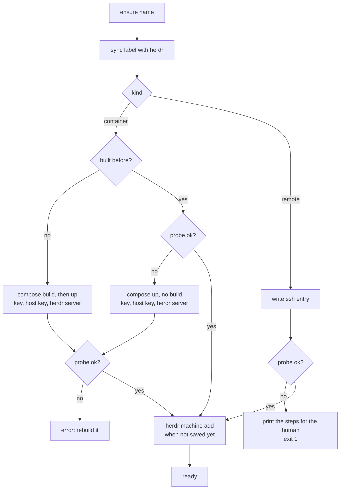

# Instances

## Goal

Give one orchestrator other machines to dispatch workers to, so that work
for different projects or Git accounts runs apart — its clones, runtimes,
logins and Docker never mix with the host's or each other's. A machine that
has stopped must not silently drop out of dispatch or listing: the plugin
brings it back, or says exactly what a human has to do.

Contract: [plugins/](../README.md). Dispatch across machines:
[orchestration.md](../../orchestration.md#several-machines). Commands, fields
and the image's contents: the [plugin README](../../../../plugins/instances/README.md).

## Non-goals

- **Starting remote hosts.** The plugin probes one and prints the steps.
- **Rebuilding implicitly.** `ensure` restarts; only `rebuild` rebuilds.
- **Moving credentials.** Each instance is logged in from inside.
- **Managing herdr machines added by hand.** The plugin lists, ensures
  and renames only the instances in its manifest.

## Design

### Instances: a fixed name and a label

An instance is a **container** (built and started on this machine) or a
**remote** host (reached over ssh, run by the human). Each has two names:

- **name** — fixed: the ssh Host alias, the herdr machine target and, for a
  container, the compose project. Everything the plugin generates is keyed
  by it, so it never changes; a new name is `rm` then `add`.
- **label** — what herdr shows, what `--machine` takes and the prefix of
  `<label>/<pane>` worker rows. The human may rename it anywhere.

herdr's machine is found by target, never by label (`machineFor`); an
argument is resolved by name, then herdr's label, then the manifest's
label (`resolve`), so either works everywhere.

### The manifest is the source of truth

`plugins/instances/instances.yml` is git-ignored (it holds addresses)
and written atomically with mode 0600. The first write copies
`instances.example.yml`, so the field reference travels with the file;
later writes keep everything above `instances:` and rewrite the entries.
It is parsed as YAML and checked field by field (`manifest.ts`): a
duplicate, an unknown or kind-foreign field, a nested value or a wrong
type stops with `instances.yml:<line>: <reason>`, and `bin/instance`
parses it before any command, so a broken manifest never half-applies.
The shape checks (`validate.ts`) are shared with the CLI and are what make
names, hosts and dirs safe in ssh config, compose and remote commands. A
text field written like a number (`label: 007`, `image: 1.10`) is kept as
written, not as the number YAML reads it as.

What the manifest does not hold lives under `~/.config/herdr-worktree/`:
per container its key, ssh config, known_hosts and the port, image and
docker setting of its last successful build (`containers/<name>/`); per remote host
its generated ssh entry (`remotes/<name>/`). Both are included from the
top of `~/.ssh/config`, so `ssh <name>` and herdr reach every instance;
`ensure` writes the Include before its first plain `ssh <name>` probe.
An Include already there counts in any form ssh takes: any case, `=`,
several paths on one line (home-manager's way), quoted or `~/` paths, a
trailing comment — but only where it applies to every host: before the
first `Host`/`Match` block, or under `Host *` or `Match all`.
Because one bad line there breaks every ssh call on the machine, every
value written into these entries is validated first (a remote's
`identity` path takes no whitespace, quotes, backslashes or control
characters), and a symlinked `~/.ssh/config` (a dotfile manager's) is
edited at its target so the link survives. When that target cannot be
written (home-manager's is in the read-only Nix store) or the link is
dangling, or the config cannot be read or written at all, `ensure` and
`ls` warn with the `Include` line to add to the file the link comes from
and go on: the probe that follows tells whether ssh reaches the instance
anyway (the line may sit in a file ssh includes that the plugin does not
read). When ssh then does not know the name at all (`Could not resolve
hostname <name>` — with a Host entry it would name the HostName, a DNS
problem), `ensure` ends on adding that line, with ssh's error, not on a
rebuild or on starting the host; any other failure keeps its usual advice.
`ls` shows such a row as unreachable.

A container is built before any of its files is written, so a failed
build changes nothing and `ensure` still notes what the manifest asks
for; a start that fails after a build (a port taken on the host) is
retried by `ensure` with the new settings. Compose tells projects apart
by name, not by file, so for a name the plugin has no build of, `add`
(before it writes the manifest) and the first build refuse when a
compose project of that name has containers from another file, or when
volumes compose would mount are already there with no container of the
plugin's — any of that project, or one named `<name>_<key>` for a volume
`compose.yml` declares, whatever made it (compose mounts by name; `rm
--purge` would then delete it). The plugin's own volumes after a plain
`rm` do not refuse the re-add, since its build state is kept; `rm --purge` of a container never built
makes no compose call. That kept state includes the container's ssh
entry, which could shadow a remote host of the same name (ssh takes the
first match), so `add remote` refuses such a name until `rm --purge
<name>` — which accepts a container no longer in the manifest — deletes
it. A name or label of a live instance always wins over such a container;
when the argument is a live label and a kept container's name at once,
`rm --purge` refuses rather than guess whose data to delete.

### Labels in step with herdr

A label can change in the manifest, through `instance rename`, or in
herdr's TUI. On `ensure` and `ls` the plugin compares both sides with
`labels.json`, the label they last agreed on (ADR-0020). If the manifest
still has that label, herdr was renamed and the manifest takes herdr's
— unless the manifest could not hold it (an invalid label, or another
instance's label in any case), in which case herdr's machine is renamed
back with a warning, so a rename in herdr can never make the manifest
unreadable; otherwise (manifest edited, both edited, or no record) the manifest wins
and herdr's machine is renamed. A label herdr cannot take (invalid, or
another machine's, ignoring case) is reported and nothing is recorded.
A rename herdr refuses is reported too, never thrown, so one machine
cannot stop `ls`; `ensure` then fails for that instance, since
`herdr --machine <label>` would name a label herdr does not have. For
the same reason `ensure`'s ready line and `ls` show herdr's label once the
machine is saved there: while a manifest label herdr cannot take is kept
out (another machine has it), printing it would point at that machine. The
manifest itself refuses a label used twice, ignoring case.

`machines` only reads (core calls it on every `list-workers.sh`): it
shows the label a sync would leave (`planLabel`, the same decision `ensure`
carries out), so a herdr label about to be put back is never reported;
the manifest's for an unsaved machine.

### Containers

One compose project per instance, named after it. The plugin passes
`compose.yml` everything as environment: the checkout as build context
(`HW_CORE_DIR`, copied to `~/herdr-worktree`), the image directory
(`HW_IMAGE_DIR`, the Dockerfile and a named context `image`), the SSH port
and the runtime.

- **Images.** `docker/default/` is versioned; any other `docker/<image>/`
  is git-ignored and local (ADR-0015). The Dockerfile reads its own files
  with `COPY --from=image`, so a copy (`image new`) needs no path edits.
- **SSH.** sshd allows public-key login for `dev` only; the port is
  published on `127.0.0.1`, one per container: `add` picks 2222 or the
  next port no other container in the manifest uses, and refuses a
  `--port` another container has. A container added back after `rm` with another
  port, image or docker setting is built with them; a port edited in the manifest is noted by
  `ensure` and applied by `rebuild`, like the image. Each instance has its own ed25519 key. The
  public key is written to `/etc/ssh/authorized_keys/dev` through
  `docker compose exec -T` stdin after every start: no bind mount, and
  `docker cp` fails on sysbox-runc containers. The entrypoint creates the
  host keys once in their own volume; the plugin pins them on first
  contact (`accept-new`) and checks them strictly afterwards.
- **A herdr server per container.** After every start the plugin starts
  `herdr server` from the checkout over ssh (`setsid -f`), opens a
  `herdr-worktree` workspace, closes the lone initial `~` one, and saves
  the container as a herdr machine once forwarding reaches it.
- **One state volume.** Logins and settings live in one volume at
  `~/.persist` (ADR-0016). At every start the entrypoint turns each path
  in `docker/<image>/persist` and in the instance's own
  `~/.persist/persist.list` into a symlink into it — on first use moving
  what the image put there, afterwards keeping the volume's copy. A new
  CLI is one line, not a compose change. Paths are taken parents first,
  and one under a path already kept is skipped: it is in the volume
  already, and linking it would delete it. `~/.persist/persist.linked`
  records each path's first use, so a parent added after its child was
  kept (`.local` after `.local/state/nix`) still has its first use: what
  the image put there is merged into the directory the child created,
  not deleted. A kept path's own link is never moved into the volume,
  where it would point at itself; other links move as they are. Each
  path is a directory, and a file or a link elsewhere (a dotfile
  manager's) is refused and left alone, so a path whose volume directory
  was deleted gets an empty one again, on a restart as on a rebuild. A
  path that cannot be linked is reported and left as it is, as is a
  record that cannot be written; the start goes on, because sshd must
  still come up. Entries that are not a plain path inside the home (`.`,
  `x/.`, `a//b`, the volume's own files) are refused, and a list's last
  line counts without a final newline. `tests/plugins/instances/` tests
  this with bats.
- **Docker inside.** `docker: true` runs the container with
  `sysbox-runc` and the entrypoint starts `dockerd`, so a worker uses the
  repository's own `docker compose` (ADR-0017). There is no
  `--privileged` and no `docker.sock`: either would reach the Docker VM's
  root, and with it every other instance. Without the runtime the plugin
  fails before compose runs.
- **`/nix` as a volume**, with Nix's profiles and fetcher cache among
  the persisted paths: `nix develop` downloads once per instance, so
  images do not bake in a toolchain the repository defines itself.

Clones and worktrees have their own volumes; the rest comes from the image.

### ensure versus rebuild

The probe (`ssh.ts`) is one ssh round trip — `git`, `gh`, `jq`, `herdr`,
the checkout, a running herdr server — answering `ok`, `unreachable`,
`missing:<tools>`, `no-checkout` or `no-server`.

`ensure` builds only a container that was never built, and otherwise
starts it with the port, image and docker setting recorded at the last
build. It never rebuilds, because a rebuild recreates the container and
stops every agent in it; core calls `ensure` on its own, mid-dispatch.
A changed image or docker setting only earns a note naming `rebuild`,
which builds from the manifest and then runs `ensure`. A container that
answers is left as it is, so `ensure` is safe to repeat.

### Remote hosts

A remote host is never started. `ensure` and `ls` regenerate its ssh
entry from the manifest (an edit applies at once), probe it, and on
failure print what to start or install, then the `ensure` to rerun. It needs
`git`, `gh`, `jq` and `herdr` on the PATH of a non-interactive ssh, a
herdr-worktree checkout at `dir`, a running `herdr server`, and the
human's key in its `authorized_keys`. A new host key is pinned in the
instance's own `known_hosts` on first contact; keys already in
`~/.ssh/known_hosts` are honored. `rm` deletes the ssh entry and changes
nothing on the host.

### Code structure

The plugin is TypeScript run by Node.js ≥ 24 through type stripping: no
build step, erasable syntax only, one runtime dependency (`yaml`). The shims
`bin/instance` and `bin/hw-plugin` check Node.js and the dependency, then
run `src/main-*.ts`.

- **`Runner`** (`proc.ts`) — the only way out to `docker`, `ssh`,
  `ssh-keygen`, `herdr` and `git`; synchronous, stdin closed unless input
  is given, so ssh never reads input meant for its caller.
- **`Ctx`** (`context.ts`) — the runner, every path (each overridable by
  an environment variable), `out` for results, `err` for messages, `sleep`.
- **Modules** — `instances.ts` (the operations and label sync) over
  `manifest.ts`, `validate.ts`, `container.ts` (compose, keys, herdr
  server, images), `remote.ts`, `ssh.ts` (probe) and `herdr.ts`.
- **`contract.ts`** — core's four calls. `ensure` writes only to stderr;
  `exec` runs `cd <dir> && HERDR_ENV=1 <cmd>` over ssh, each argument
  quoted, passing output and exit status through. `cli.ts` parses both
  command lines.

**Why TypeScript here and bash in core.** In shell the feature needed a
hand-written YAML subset, `jq` for every JSON answer, and stub executables
on `PATH` for tests, and ssh reading a loop's stdin silently skipped
machines (ADR-0018). The plugin runs only on the driving machine, so it
may require Node.js; core also runs in every instance and on remote hosts,
where only the README requirements hold, so it stays bash.

## Failure handling

- **One instance fails, the rest continue**; `ensure` exits 1 if any is
  still unusable.
- **A container still unusable** after a start is reported with its
  probe result and the `rebuild` command.
- **sshd not yet listening** after `compose up`: the login is retried up
  to 60 times, a second apart. A changed host key fails instead of being
  re-pinned; the message says to `rm --purge` and add the instance again.
- **dockerd that fails** is logged; sshd still starts for diagnosis.
- **An unreadable herdr list or `labels.json`** counts as empty.

## Security

- Containers allow public-key login only, for `dev` only, on loopback;
  root and passwords are refused. The plugin installs the instance's own
  key; keys and ssh state sit in 0700 directories under `~/.config`.
- Nothing is bind-mounted from the host and no Docker socket is passed in,
  so the Docker VM needs no access to the home directory; Docker inside
  goes through Sysbox's user namespaces instead of `--privileged`.
- Credentials are never copied in; `rm --purge` deletes them. Values
  reach ssh config and remote shells only after the shape checks.
- `dev` has passwordless `sudo` inside, and workers run unconfined
  (ADR-0007): the container is the boundary, not the user account.

## Testing

`npm run check` in `plugins/instances` runs `tsc --noEmit` (strict) and
`node --test` over `test/*.test.ts` (CI job `plugin-instances`).
`test/helpers.ts` builds a `Ctx` over a temporary directory and a `World`
that holds herdr's machines, ssh probe answers and compose projects in
memory behind the `Runner` and records every call — no stub executables,
no Docker. Core's side uses a fake plugin (`stub_plugin` in
`tests/scripts/helpers.bash`).

A real container is checked with `instance check <name>`: tool versions,
the herdr server and workspace, every `tests/scripts/*.bats` and
`tests/scripts/lib/*.bats` run inside, and herdr's forwarding.

## References

- ADRs: [ADR-0007](../../../adr/0007-no-confinement.md),
  [ADR-0013](../../../adr/0013-ubuntu-dev-container.md),
  [ADR-0014](../../../adr/0014-instance-manifest.md),
  [ADR-0015](../../../adr/0015-custom-container-images.md),
  [ADR-0016](../../../adr/0016-one-state-volume.md),
  [ADR-0017](../../../adr/0017-docker-inside-with-sysbox.md),
  [ADR-0018](../../../adr/0018-plugins-and-typescript-instances.md),
  [ADR-0020](../../../adr/0020-two-way-label-sync.md). They are point-in-time:
  where file names or commands differ, the code is current.
- Docs: [plugins/](../README.md),
  [orchestration.md](../../orchestration.md#several-machines), the
  [plugin README](../../../../plugins/instances/README.md) (commands, fields,
  installed tools, volumes, Sysbox setup).
- Code: `plugins/instances/src/`, `compose.yml`, `docker/default/`,
  `instances.example.yml`, `test/`.
