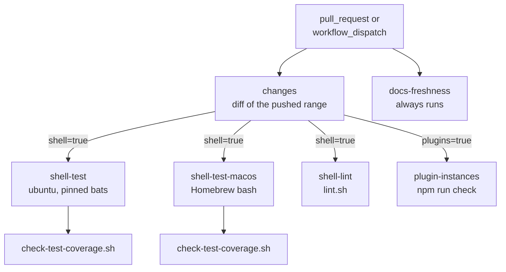

# Quality

## Goal

Every change to herdr-worktree has to show that it works before a human
merges it, without herdr, agent CLIs, GitHub or other machines being
involved. The scripts drive all of those, so the tests replace them with
stubs and check what the scripts do with them. Three cheap gates (test
pairing, doc freshness, shellcheck) catch what reviewers tend to miss, and
CI runs the same commands a contributor runs locally.

## Non-goals

- **No end-to-end run against real herdr, agent CLIs or hosts.** The
  tests show that the scripts make the right calls and handle the answers,
  not that today's releases still give them ([Trade-offs](#trade-offs)).
- **No coverage percentage.** The gate checks that a test file exists;
  what it tests is left to review.
- **Hooks are early feedback.** CI is what a PR has to pass.

## Design

### Shell tests: bats, one file per unit

The shell tests are [bats-core](https://github.com/bats-core/bats-core)
files (ADR-0021). `scripts/<name>.sh` is tested by
`tests/scripts/<name>.bats`, and `scripts/lib/<name>.sh` by
`tests/scripts/lib/<name>.bats`; a plugin's shell files are tested under
`tests/plugins/<id>/`. Each `@test` stands alone: one failure
names its test while the others still run, and `bats --filter` runs a
single test. `bats --recursive tests/` runs everything.

Every file starts with `load helpers` (`tests/scripts/helpers.bash`), which
provides:

- **A scratch dir per test.** `common_setup` creates a fresh `$t` under
  `/tmp` and `common_teardown` removes it. The path is kept short on
  purpose: macOS's per-user `TMPDIR` is long enough to break the herdr
  socket paths that some scripts build from it. `common_setup` also points
  `HW_PLUGINS_DIR` and `HW_SKILLS_DIR` at empty dirs and unsets
  `CLAUDE_CONFIG_DIR` and `PI_CODING_AGENT_DIR`, so plugins or skills
  enabled in the checkout and real agent configs never leak into a test.
- **`expect_*` assertions** (`expect_rc`, `expect_eq`, `expect_file`,
  `expect_grep`, `expect_not_grep`). A failing assertion prints what it
  got and returns 1. Bats runs test bodies with errexit, so that fails the
  test. A command that is expected to fail runs through `run`.
- **Stubs in `$stub_bin`, first on `PATH`.** `stub_gh` clones from local
  bare repos made by `seed_origin` and serves or captures PR bodies;
  `stub_herdr` returns canned JSON, with switches for a stalled prompt, a
  lost paste and a hung `agent start`; `stub_agent_clis` answers the
  queries `agent-models.sh` makes; `stub_plugin <id>` is a fake plugin
  answering from files ([plugins/](plugins/README.md#testing)). The gh, herdr
  and plugin stubs log every call, so tests assert on call sequences too.

The suite needs the README requirements (bash, git, gh, jq) and bats, and
no network or real herdr.

### Sourceable scripts and status-returning modules

A unit test needs a function it can call directly. Two rules make that
possible ([../reference/shell-style.md](../reference/shell-style.md) §1,
§7):

- **Main guard.** Every `scripts/*.sh` ends with
  `if [[ "${BASH_SOURCE[0]}" == "$0" ]]; then set -euo pipefail; main "$@"; fi`.
  When the script is executed, it behaves as before. When a test sources
  it, it only defines functions, and the strict flags stay out of the bats
  process. The cost is that top-level code before `main` has to stay
  trivial: constants and `source` lines only.
- **Modules return; they do not exit.** `scripts/lib/<topic>.sh` only
  defines `hw_` functions. On failure a function prints `Error: …` and
  returns 1. Only `hw_die` exits. A test can `run hw_base_branch <clone>`
  and check the status without its own shell being killed, and each caller
  decides whether a failure stops it (`hw_wait_for_agent … || exit 1`).

So a test either runs a script end to end against stubs (the call
sequence and prompt preamble of `spawn-repo-agent.sh`), or sources a
module and calls one function with fixtures (`hw_json_merge` on a corrupt
file). [../reference/scripts.md](../reference/scripts.md#scriptslib) lists
the modules.

The git hooks are never sourced, keep the plain header form and have no
bats file of their own. `create-worktree.bats` tests the installed
`pre-commit` blocking a commit to `master`; `setup-hooks.bats` tests where
the links land.

### The plugin's TypeScript tests

The `instances` plugin is TypeScript run directly by Node.js, with no
build step. `npm run check` runs `tsc --noEmit` (strict, erasable syntax
only), then `node --test` over `test/*.test.ts`. Every external command
goes through one injected `Runner`; `test/helpers.ts` swaps it for an
in-memory `World` of herdr machines, ssh probe answers and running compose
projects, and a no-op sleep. Each test gets its own directory under the
checkout's git-ignored `tmp/tests/`, never a shared temp dir, removed when
its test file ends; it asserts on the World, the recorded calls and the
printed lines
([../../plugins/instances/README.md](../../plugins/instances/README.md#development)).

### Gates

| Gate | Fails when |
|---|---|
| `scripts/check-test-coverage.sh` | a `scripts/*.sh` has no `tests/scripts/<name>.bats`, or a `scripts/lib/*.sh` has no `tests/scripts/lib/<name>.bats` |
| `scripts/check-docs-stale.sh [base]` | `MISSING`: a `sources:` path no longer exists. `STALE`: a source changed between `merge-base(base, HEAD)` and `HEAD`, and the doc did not |
| `scripts/lint.sh` | `shellcheck -x` reports anything on tracked `*.sh`, `*.bats`, `*.bash`, `scripts/hooks/*` or `plugins/*/bin/*` |

**Coverage** makes the pairing rule mechanical instead of a review item.
**Docs freshness** stops docs from drifting away from the code. It reads
the inline `sources: [a, b]` of `docs/design/**/*.md`, `docs/reference/*.md`
and `plugins/*/README.md`. A file source has to appear in the diff
exactly, and a directory source matches any changed file under it. A doc
with `sources: []`, such as the prescriptive `shell-style.md`, is skipped.
**ADRs are exempt on purpose.** An ADR records a decision at a point in
time and is never edited to follow the code
([CONTRIBUTING.md](../../CONTRIBUTING.md#documentation)); checking ADRs
would force edits to immutable records. A changed decision gets a new
ADR, and design docs like this one describe the current state.

**Lint** catches quoting and expansion bugs tests do not reach. It
prefers the git-ignored `tools/shellcheck`, else `PATH`, and lints tracked
files only, tests included (each `.bats` disables SC2154 before `load`,
which shellcheck does not follow).

### Git hooks

`scripts/hooks/` is linked into the common git dir, here by
`setup-hooks.sh` and in prepared repositories by `create-worktree.sh`
(never replacing a repository's own hooks).

- **`pre-commit`** blocks a commit to `main` or `master`, and one on a
  branch whose PR is already merged or closed (asked through `gh`). A
  detached HEAD, how a dispatched task worktree starts, passes.
- **`pre-push`** prints PR-workflow reminders, then runs the repository's
  own `check-docs-stale.sh` (against `origin/main`) and
  `check-test-coverage.sh` when they exist, blocking the push on failure.
  A target repository without them gets only the reminders.

The hooks run only the fast gates, which need nothing beyond git. bats,
shellcheck and `npm run check` are slower and need the dev tools, so they
are left to the contributor and to CI.

### CI

[`.github/workflows/ci.yaml`](../../.github/workflows/ci.yaml) runs on
`pull_request` and `workflow_dispatch`.

- **`changes`** decides which other jobs run. On `synchronize` it diffs
  only the commits just pushed (`before..after`). On open or reopen it
  diffs against the PR base. A manual dispatch runs everything.
  - `shell` is set by a change to `*.sh`, `*.bats`, `*.bash`,
    `scripts/hooks/`, `plugins/*/bin/` or the workflows.
  - `plugins` is set by a change to `plugins/` or the workflows.

  A `paths:` filter on the trigger would evaluate the whole PR diff, so a
  docs-only push to a branch that already touched a `.sh` file would rerun
  every suite.
- **`shell-test`** (Ubuntu) and **`shell-test-macos`** run
  `bats --recursive tests/` and then `check-test-coverage.sh`, with
  bats-core cloned at a pinned tag so every run uses the same bats. macOS
  gets Homebrew bash (its `/bin/bash` is 3.2; the scripts need 4.3 or
  later) and checks the version first; this job enforces ADR-0011.
- **`shell-lint`** runs `lint.sh` with shellcheck from the runner's
  package archive.
- **`plugin-instances`** runs `npm ci` and `npm run check` on Node.js 24,
  the version the plugin's `engines` field requires as a minimum.
- **`docs-freshness`** always runs `check-docs-stale.sh` against the PR
  base. It is cheap, and a doc can derive from any file, not only from
  shell scripts.

Runner images and action versions live in the workflow file only.

### Toolchains, updates and instances

- **Dev shell.** `nix develop` (`flake.nix`, pinned by `flake.lock`) adds
  only development tools: `shellcheck`, `bats`, `nodejs_24`.
- **Dependabot** opens weekly PRs, which go through the same CI, for
  GitHub Actions and the plugin's npm dependencies (dev dependencies
  grouped). The bats tag in the workflow, the shellcheck release in
  `lint.sh`'s install hint and `flake.lock` are bumped by hand.
- **Inside a container.** The plugin's default image installs bats, and
  `instance check <container>` runs each `tests/scripts/*.bats` and
  `tests/scripts/lib/*.bats` in the container's checkout over ssh,
  reporting ok or fail per file next to its tool and herdr checks. That
  shows the suite passes where workers run
  ([../../plugins/instances/README.md](../../plugins/instances/README.md)).

## Trade-offs

- **Stubs instead of real herdr and CLIs.** Stubs make the suite fast,
  repeatable, secret-free in CI, and able to produce failures that are
  hard to trigger for real (a stalled prompt, a lost paste, a hung start).
  The price: a stub encodes what herdr or a CLI answered when it was
  written. If a release changes its JSON, error codes or help text, the
  tests stay green and the scripts break; real use catches that drift.
- **Not covered:** live agent CLIs (login, first-run dialogs, today's
  model lists), real remote hosts and ssh, Docker builds and images
  (`instance check` covers a built container, by hand). Core's tests load
  only `stub_plugin`; the plugin's own tests cover its contract output.
- **Pairing, not depth.** One trivial `@test` satisfies the coverage gate;
  it makes a missing test a visible decision, nothing more.
- **Changed-range CI.** Diffing only the pushed commits saves runner time.
  A later docs-only push does not rerun the suites, so the earlier green
  run stands for code that has not changed since.
- **Version skew.** CI pins bats but takes shellcheck from the runner
  image; locally both come from Nix or a package manager. CI is what
  counts.

## Testing

The gates have bats files of their own:

- `check-test-coverage.bats` covers a missing script test, a missing
  module test, and an old-style `test-*.sh` that does not count.
- `check-docs-stale.bats` builds a throwaway git history to cover STALE,
  MISSING, a source changed together with its doc, and the ADR exemption.
- `lint.bats` uses a stub shellcheck to cover which files get passed, that
  `tools/shellcheck` is preferred, that a failure propagates, and that
  having no shellcheck at all is an error.

The local commands are in [CONTRIBUTING.md](../../CONTRIBUTING.md#tests).

## References

- [ADR-0021](../adr/0021-bats-and-sourceable-modules.md): bats, sourceable
  scripts, `scripts/lib` modules and the coverage gate.
  [ADR-0011](../adr/0011-macos-portability.md): macOS support and its CI
  job. [ADR-0018](../adr/0018-plugins-and-typescript-instances.md): the
  TypeScript plugin.
- [CONTRIBUTING.md](../../CONTRIBUTING.md),
  [../reference/shell-style.md](../reference/shell-style.md),
  [../reference/scripts.md](../reference/scripts.md) (gates, modules,
  hooks), [plugins/](plugins/README.md) (testing core against a plugin).
- Code: `tests/scripts/helpers.bash`, `plugins/instances/test/helpers.ts`,
  `.github/workflows/ci.yaml`, `.github/dependabot.yml`, `flake.nix`.
