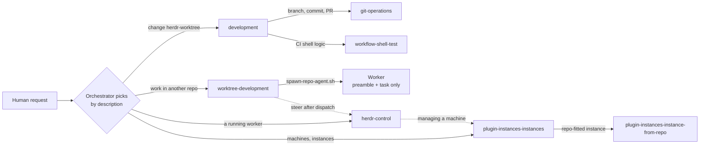
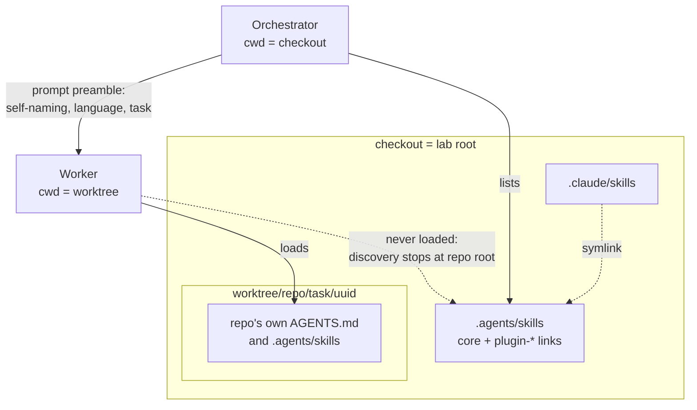

# Skills

## Goal

Give the orchestrator — the agent running at the lab root — every rule
and procedure it needs, without any of it reaching the workers it
dispatches. A worker must see only its target repository's conventions;
the orchestrator must still find the right procedure from a
natural-language request.

## Non-goals

- No root `AGENTS.md` or `CLAUDE.md`, and no always-on context of any
  kind for this repository (ADR-0005).
- Skills do not restrict tools or enforce rules: their frontmatter is
  `name` + `description` only, and there are no guard hooks (ADR-0007;
  why `allowed-tools` stays unset is in
  [../reference/skills.md](../reference/skills.md#frontmatter)).
- Workers get none of these skills. herdr-worktree adds nothing to a
  worker's repository.
- Skills do not restate what a script or reference doc already says.

## Design

### No root context files

Agents such as pi load `AGENTS.md`/`CLAUDE.md` from the working directory
and every parent directory. Task worktrees live under `worktree/`, which
sits inside this checkout in the unified topology, so a root context file
here would be loaded by every worker beneath it — breaking the rule that a
worker follows only its target repo. Claude Code reached the same file
through a root `CLAUDE.md` import and stopped at its external-imports
dialog (ADR-0005).

The must-follow rules therefore live in the `development` skill, which
the orchestrator loads before editing this repository. The cost is that
the rules apply only once a skill is loaded, not in every session; skill
descriptions carry the routing that a root file would otherwise carry.

### One canonical location

`.agents/skills/<name>/SKILL.md` is canonical; `.claude/skills` is a
symlink to `../.agents/skills`, so every supported CLI lists the same
set. Which CLI reads which directory is in
[../reference/agent-configs.md](../reference/agent-configs.md).

### The core skills and their hand-offs

The orchestrator sees only each skill's description until it loads one;
the descriptions are written so that each request lands on exactly one
skill, and each body names the sibling that takes over at its boundary.

| Skill | Triggers on | Hands off to |
|---|---|---|
| `development` | Any edit to this checkout (scripts, skills, docs, tests) | `git-operations` for Git and PRs; `worktree-development` for any other repository |
| `git-operations` | Cloning, branching, committing, PRs — scoped to herdr-worktree work only, "used only from the development skill" | Back to `development` |
| `worktree-development` | Work on any repository other than herdr-worktree | `herdr-control` once the worker runs; the plugin's skill when a machine needs the human's action |
| `herdr-control` | The human refers to a worker, a pane/tab or a dispatched task | `worktree-development` for new work; the plugin's skill for managing machines |
| `workflow-shell-test` | Extracting shell logic from GitHub Actions workflows and covering it with bats | — |

The full purpose of each is in [../reference/skills.md](../reference/skills.md).
Routing rests on three patterns in the descriptions:

- **What and when** — a capability, then `Use when …`/`Use whenever …`.
- **Example utterances** — quoted phrases the human actually says ("go
  to the DB role worker", "is hw-a up?"), so a request that never names
  the skill still matches it.
- **Boundaries** — each description names where its scope ends and who
  takes over ("For any other repository, use worktree-development";
  "New dispatches go through worktree-development"), so `development`
  and `worktree-development` split the work between this repository and
  every other one without a root file deciding it.

`workflow-shell-test` is a general procedure: it puts extracted scripts
under `.github/scripts/<workflow>/` and tests under
`tests/<workflow>/`. This repository's own scripts and tests follow
`CONTRIBUTING.md` instead (`scripts/`, `tests/scripts/`), and its CI keeps
change detection inline in `.github/workflows/ci.yaml`.

### Orchestrator and worker

The skills assume an agent at the lab root. A worker starts with its cwd
in the task worktree, so it loads that repository's `AGENTS.md` and
`.agents/skills` plus its own global configuration — never these skills.
The worktree is its own repository root, where pi's skill discovery
stops; pi's trust check still sees `.agents/skills` above it, so
`hw_trust_worktree` (`scripts/lib/agent-trust.sh`) pre-trusts the
worktree and declines Claude Code's external `CLAUDE.md` imports
(ADR-0009).

What a worker learns about herdr-worktree is exactly the prompt
`spawn-repo-agent.sh` sends: its pane and tab ids, the self-naming
contract (`herdr agent rename`, `herdr tab rename`, slug rules), the
language rule, and the task — or, with no task, a standby instruction
carrying the same contract (ADR-0004). Follow-up instructions arrive
through `herdr-control` as plain English prompts.

### Plugin skills

A plugin's skills are how the orchestrator learns to manage what the
plugin provides. ADR-0018 kept them inside the plugin and let
`herdr-control` point to them; asked "is the instance up?", a fresh
orchestrator never loaded `herdr-control` — the request is about
machines, not workers — and answered from the manifest after searching
the checkout. Only what is listed under `.agents/skills` is matched by
description (ADR-0019).

`scripts/plugins.sh enable` therefore links each skill directory the
plugin's `describe` names as `.agents/skills/plugin-<id>-<name>`
(`link_skills`). `<name>` is the `name:` in the skill's frontmatter,
or the directory name when there is none. The links are git-ignored
(`.agents/skills/plugin-*`) and point at absolute paths, so
`.dockerignore` keeps them out of image builds; `enable` records them in
`.plugins/.<id>.skills` and `disable` removes them with the plugin link. The prefix keeps the ignore pattern from hiding a
core skill, so no core skill may be named `plugin-*`. How the contract
names skills is in [plugins/](plugins/README.md).

For the `instances` plugin this lists `plugin-instances-instances`
(list, ensure, rename, add, rebuild, remove machines) and
`plugin-instances-instance-from-repo` (build an instance fitted to a
repository). Their descriptions use the words the human uses —
"instances", "containers", "machines", a label, an IP — so they trigger
directly, and `herdr-control` names `plugin-instances-instances` for a
machine request that reaches it first.

### Language contract

Agents think in English and reply to the human in the human's language
(ADR-0012). The rule lives where it applies:

- `worktree-development` and `herdr-control` state it for the
  orchestrator; task text and relayed prompts are written in English,
  with quoted text, identifiers and file names kept verbatim.
- `spawn-repo-agent.sh --reply-lang <language>` puts it into the
  worker's preamble (task and standby); without the flag the preamble
  says to reply in the language the human writes in. The orchestrator
  always passes it.
- A human who switches languages mid-task gets
  `Reply in <language> from now on.` appended to the next relayed prompt
  (`herdr-control`).
- `git-operations` keeps PR titles, bodies and Decision Logs in English;
  the `instances` skill relays a remote host's start-up steps in the
  human's language.

### Skills cite, scripts implement

A skill tells the orchestrator *which* command to run and *when*; the
script holds the behavior and its usage header is the contract.
`worktree-development` names `spawn-repo-agent.sh` as the only dispatch
entry point and `agent-models.sh` for model ids; `herdr-control` names
`list-workers.sh`; `development` names `bats`, `lint.sh`,
`check-test-coverage.sh` and `append-pr-log.sh`; the `instances` skill
points to `bin/instance --help` and `instances.example.yml` instead of
listing fields. Script inventories live in
[../reference/scripts.md](../reference/scripts.md), the architecture in
the design docs, and longer material in a skill's own `reference/`
(`instance-from-repo` reads `reference/sources.md` only when needed).

The reason is drift: skills carry no `sources:` and escape
`check-docs-stale.sh` (CONTRIBUTING.md reviews them by hand), so a
restated flag list rots silently; a pointer to the script does not.

## Failure handling and edge cases

- **Skill not loaded** — the rules simply do not apply; nothing enforces
  them. The `development` description says to load it before editing
  anything here, and the pre-commit hook still blocks commits to `main`.
- **Plugin enable refused** — a described skill without `SKILL.md`, a
  name already used by a core skill or another plugin's, or the same
  name described twice stops `enable` before anything is linked.
  Re-enabling replaces the plugin's links; run `enable` again after
  moving a plugin, or in a checkout enabled before skill linking existed.
- **Language drift** — the contract is a prompt instruction; an agent can
  drift, and the fix is a relayed reminder, not a check.

## Security

Skills grant nothing (ADR-0007). Enabling a plugin adds its instructions
to the orchestrator's listing, so a plugin is trusted like code here.

## Testing

- `tests/scripts/plugins.bats` — `enable` links each described skill as
  `plugin-<id>-<name>`, refuses a clash with a core skill before linking,
  `disable` removes only the links, and `skill_name` (sourced) reads the
  frontmatter name.
- `tests/scripts/helpers.bash` points `HW_SKILLS_DIR` and
  `HW_PLUGINS_DIR` at empty scratch dirs, so a plugin enabled in the
  checkout never leaks into a test.
- `tests/scripts/spawn-repo-agent.bats` — task and standby prompts carry
  the language rule; `--reply-lang` names the reply language.
- `plugins/instances/test/cli.test.ts` — `describe` names the plugin's
  skills.
- Skill bodies and triggering have no automated test; ADR-0019 came from
  trying natural-language requests on a fresh orchestrator, which is the
  check to repeat when a description changes.

## References

- [ADR-0005](../adr/0005-skills-instead-of-root-context-files.md) no
  root context files; [ADR-0006](../adr/0006-develop-in-checkout.md)
  develop in the checkout; [ADR-0009](../adr/0009-pre-answer-first-run-dialogs.md)
  pre-trusted worktrees; [ADR-0012](../adr/0012-language-contract-and-worker-steering.md)
  language contract; [ADR-0019](../adr/0019-link-plugin-skills.md)
  plugin skill links
- [orchestration.md](orchestration.md), [plugins/](plugins/README.md),
  [../reference/skills.md](../reference/skills.md),
  [../reference/agent-configs.md](../reference/agent-configs.md)
- Code: `.agents/skills/*/SKILL.md`, `plugins/instances/skills/*/SKILL.md`,
  `scripts/plugins.sh` (`link_skills`), `scripts/spawn-repo-agent.sh`
  (prompt preamble), `scripts/lib/agent-trust.sh`
