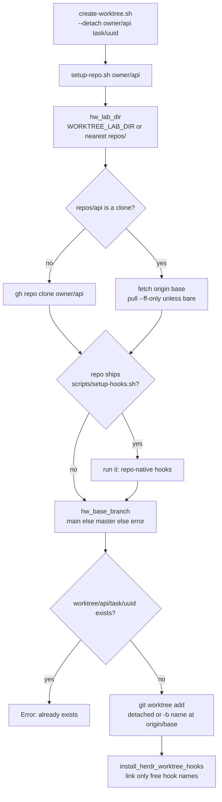

# Worktrees

## Goal

Give every task its own checkout of the target repository, started from
the remote's current base branch, so that tasks in the same repository run
side by side without sharing a branch, an index or uncommitted files — at
the cost of one clone per repository, not one per task.

- One **base clone** per repository, `repos/<repo>`, imported and refreshed
  by `setup-repo.sh` and never edited.
- One **task worktree** per task, `worktree/<repo>/<name>`, created by
  `create-worktree.sh` and the only place edits happen (ADR-0002).
- Git hooks that guard the base branch reach every clone the lab holds.

## Non-goals

- **No enforcement.** "The base clone is never edited" and "edit only in
  your worktree" are conventions; workers run unconfined (ADR-0007). The
  pre-commit hook is the one guard, and it only stops commits on `main` or
  `master`.
- **GitHub only.** Clones go through `gh repo clone` and rely on `gh`'s
  authentication; SSH remotes are not supported (see [README.md](README.md)).
- **No automatic cleanup.** Nothing removes a finished worktree or its
  branch; the orchestrator does that after the human approves (see
  [orchestration.md](orchestration.md#ownership-and-cleanup)).
- **Not for herdr-worktree itself**, which is changed in its own checkout
  on a feature branch (ADR-0006).

## Design

### The lab

The lab is the directory that holds `repos/` and `worktree/`:

```
<lab>/
├── repos/<repo>/                 # base clones, one per repository
└── worktree/<repo>/<name>/       # task worktrees; <name> is the branch
                                  # or task/<id> for a dispatched task
```

Two layouts work, and `hw_lab_dir` (`scripts/lib/lab.sh`) finds the lab
the same way for every script that needs it (`setup-repo.sh`,
`list-workers.sh`; ADR-0021):

- **Nested** — `repos/` and `worktree/` sit inside the herdr-worktree
  checkout. `.gitignore` lists both, so they are never staged.
- **Split** — the checkout sits at `<lab>/<any>` next to `<lab>/repos` and
  `<lab>/worktree`, which keeps the lab out of the checkout entirely.

`hw_lab_dir <checkout>` returns `WORKTREE_LAB_DIR` when it is set;
otherwise the nearest directory at or above the checkout that has a
`repos/` directory; otherwise the checkout itself, which becomes a fresh
nested lab when `setup-repo.sh` creates `repos/`. One lookup matters
because the scripts must agree: before it, `list-workers.sh` assumed the
checkout's parent and saw no worker in the split layout (ADR-0021).
`create-worktree.sh` takes the lab from the clone path `setup-repo.sh`
printed, so a worktree always lands next to its clone.

The upward search takes the first `repos/` it meets, so a checkout below
an unrelated directory with `repos/` (a home directory, say) would adopt
it; `WORKTREE_LAB_DIR` pins the lab, as the tests do.

### Importing a repository

`setup-repo.sh <[org/]repo>` makes `repos/<repo>` present and current, and
prints its absolute path as the only line on stdout; progress and hook
output go to stderr so callers can capture the path.

- **Org resolution.** `owner/api` names the org directly; a bare `api`
  takes the org from `GH_ORG`. The org is needed only to clone: an
  existing clone is updated from its own `origin`, so a bare name works for
  any repository already in the lab, and a missing org with no clone is an
  error.
- **Clone** — `gh repo clone`, so `gh`'s login covers private repos.
- **Update** — fetch only the base branch from `origin`, then
  `pull --ff-only`. A bare base clone (recognised by a top-level `HEAD`
  file) has no working tree, so it stops after the fetch; the fetch already
  refreshed `origin/<base>`, which is all `create-worktree.sh` reads.
- **Repo-native hooks** — when the clone ships `scripts/setup-hooks.sh`,
  it is run once at the base clone (see [Git hooks](#git-hooks)).

Base clones are keyed by repository name alone, so two repositories with
the same name from different orgs cannot share a lab. When the argument
names an org (`other/api`) and `repos/api` is a clone of another org's
`api` (read from the configured `origin` URL, ignoring case), the script
stops with both names instead of silently working in the wrong
repository. A bare name, or an origin that is not a GitHub URL, is not
compared. Keeping both would mean `repos/<org>/<repo>` and org-aware
worktree paths and workspace labels — not done yet.

### The base branch

`hw_base_branch` (`scripts/lib/repo.sh`) picks `main` when origin has it,
else `master`, else fails with an error naming both. It reads the
remote-tracking refs a clone or fetch left first, and asks origin with
`git ls-remote` only when those are missing (a bare clone has none). The
update fetch and the task worktree use the same answer, and `pre-commit`
guards both names, so a master-only repository works end to end.

### Creating a task worktree



`create-worktree.sh [--detach] <[org/]repo> <name>` always starts from
`origin/<base>`, never from the base clone's local branch, so whatever the
base clone has checked out does not leak into a task.

- **Named branch** (default) — `git worktree add -b <name>`: for work whose
  branch is known up front, such as `feat/billing`.
- **Detached** (`--detach`) — a detached HEAD at `origin/<base>`. This is
  what dispatch uses: `spawn-repo-agent.sh` creates `task/<id>` with a
  12-hex-character id, so concurrent dispatches never collide, and names
  no branch. The worker names one later, if it needs one, by its own
  repository's conventions; the prompt says nothing about branches.

Detached is the dispatch default for two reasons: the dispatcher cannot
pick a meaningful branch name before the worker has understood the task,
and git refuses to check out one branch in two worktrees, so a
pre-assigned name would be one more thing that can collide.

### Why one worktree per task, and a base clone that is never edited

- **Isolation without copies.** Worktrees share the base clone's object
  store, so a new task costs a checkout, not a clone, and any number of
  tasks per repository can run at once.
- **A clean, shareable base.** Every task worktree hangs off the base
  clone's git directory. If the base clone carried edits or local commits,
  `pull --ff-only` would refuse to update it and every later dispatch for
  that repository would fail; keeping it untouched keeps it a mirror of
  origin.
- **The repository's own context loads.** A worker's cwd is a real
  checkout of the target repository, so its `AGENTS.md` and skills apply
  (see [README.md](README.md)).

### Git hooks

Linked worktrees share the common git directory, and so its `hooks/`.
Hooks are therefore installed once per base clone and cover every task
worktree of that repository. Two sources fill that directory:

1. **Repo-native hooks.** A repository that ships `scripts/setup-hooks.sh`
   installs its own hooks; `setup-repo.sh` runs that script at the base
   clone on every call. herdr-worktree's own `setup-hooks.sh` is such a
   script: it links each file in `scripts/hooks/` into the common git dir,
   overwriting what is there, and is how a herdr-worktree checkout gets its
   hooks (run it once; nothing else installs them there).
2. **herdr-worktree's hooks.** After adding the worktree,
   `create-worktree.sh` (`install_herdr_worktree_hooks`) links each hook in
   herdr-worktree's `scripts/hooks/` into the base clone's git directory,
   but only where the name is free or already one of its own links. A
   regular file is the repository's own hook and a symlink pointing
   elsewhere is someone else's; both stay, and neither stops the run.
   Repo-native hooks therefore win per hook name.

Both scripts link to the hooks in the **main checkout** of
herdr-worktree (the parent of its common git dir), not to the copy in
whichever worktree ran the script: a link into a worktree would dangle
once that worktree is removed. Links rather than copies mean a hook change
reaches every clone at once.

| Hook | Effect in a managed clone |
|---|---|
| `pre-commit` | Refuses commits on `main` or `master`, which also blocks commits in a base clone, and on a branch whose PR is merged or closed (`gh pr view`). A detached HEAD has no branch name and passes. |
| `pre-push` | Prints PR-workflow reminders; runs the repository's `scripts/check-docs-stale.sh` and `scripts/check-test-coverage.sh` when it ships them, and blocks the push when they fail. |

A repository that sets `core.hooksPath` (as husky does) makes git ignore
the common `hooks/`, so herdr-worktree's hooks do not run there.

## Failure handling and edge cases

| Situation | Result |
|---|---|
| Bare name, no `GH_ORG`, no clone | Error; nothing is cloned |
| `<org>/<repo>` while `repos/<repo>` is a clone from another org | Error naming both; nothing is fetched |
| Origin has neither `main` nor `master` | Error naming both; a first run leaves the fresh clone in `repos/` but creates no worktree |
| `worktree/<repo>/<name>` already exists | Error; the existing worktree is untouched (the base clone was still refreshed) |
| Named branch already exists | `git worktree add -b` fails and the script stops |
| Base clone with local commits or a diverged branch | `pull --ff-only` fails; the base clone needs fixing by hand |
| Origin renames `master` to `main` after the clone | The base is decided from the refs already fetched, so the stale `origin/master` is chosen and its fetch fails; a full `git fetch --prune origin` in the base clone fixes it |

## Portability (macOS)

The scripts run on Linux and macOS (ADR-0011). For this area:

- The scripts and hooks start with `#!/usr/bin/env bash` and need
  bash 4.3 or later — `pre-commit` lowercases with `${var,,}`. On macOS,
  Homebrew's bash must come before `/bin/bash` (3.2) on `PATH`, including
  for the git and agent processes that run the hooks.
- Paths come from `git rev-parse --path-format=absolute`, which needs git
  2.31 or later.
- Only BSD-compatible tool forms are used: plain `readlink` (no `-f`) to
  recognise our own hook links, and a basic-regex `sed` to read the org
  from a remote URL.

## Testing

- `tests/scripts/lib/lab.bats` and `tests/scripts/lib/repo.bats` — every
  branch of `hw_lab_dir` and `hw_base_branch`.
- `tests/scripts/setup-repo.bats` — first clone with repo-native hook
  install, later fetch, a master-only repository, org resolution, and
  `parse_repo_arg` called after sourcing the script.
- `tests/scripts/create-worktree.bats` — named and detached worktrees, a
  master-only repository whose base clone then refuses a direct commit, the
  neither-branch refusal, the existing-worktree refusal, and hook
  installation that spares repo-native files and foreign links.
- `tests/scripts/setup-hooks.bats` — run from the main checkout or a
  linked worktree, links land in the common git dir.

`gh` is stubbed to clone from a local bare origin; `WORKTREE_LAB_DIR`
points every test at a scratch lab.

## References

- [ADR-0002](../adr/0002-one-worktree-per-task.md) — one detached worktree
  per task; base clones never edited (written before the `master`
  fallback; the code now starts from `main`, else `master`)
- [ADR-0006](../adr/0006-develop-in-checkout.md) — herdr-worktree is
  developed in its own checkout; the lab directories are git-ignored
- [ADR-0007](../adr/0007-no-confinement.md) — no confinement
- [ADR-0011](../adr/0011-macos-portability.md) — macOS portability
- [ADR-0021](../adr/0021-bats-and-sourceable-modules.md) — bats,
  sourceable modules, one lab lookup
- [../reference/scripts.md](../reference/scripts.md) — each script's
  contract and the `scripts/lib` and `scripts/hooks` tables
- [orchestration.md](orchestration.md) — dispatch, which creates task
  worktrees through `spawn-repo-agent.sh`
- [plugins/](plugins/README.md) — machines with their own checkout and lab
- Code: `scripts/setup-repo.sh`, `scripts/create-worktree.sh`,
  `scripts/setup-hooks.sh`, `scripts/hooks/`, `scripts/lib/{lab,repo}.sh`
